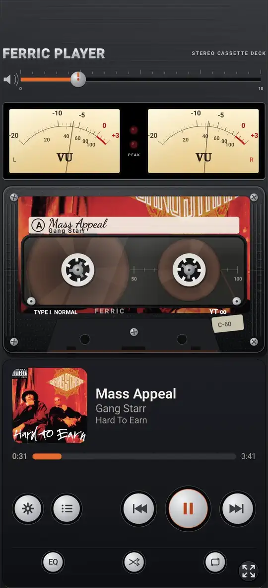
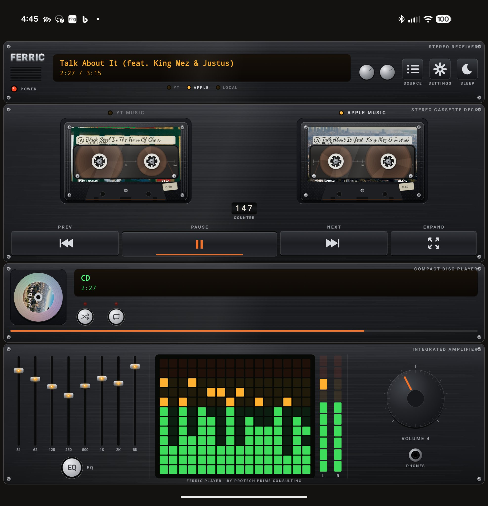
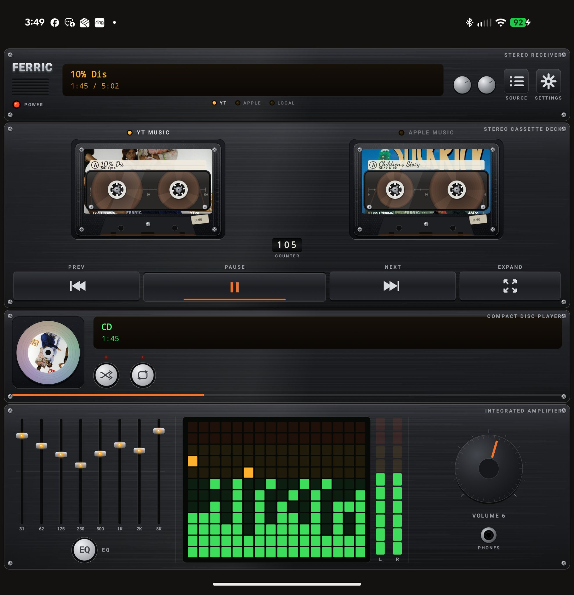
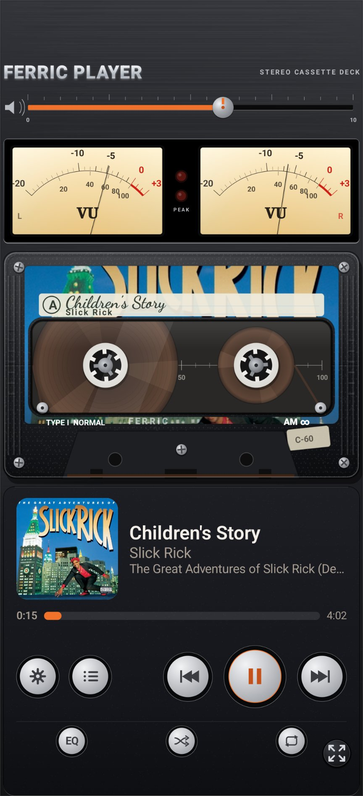
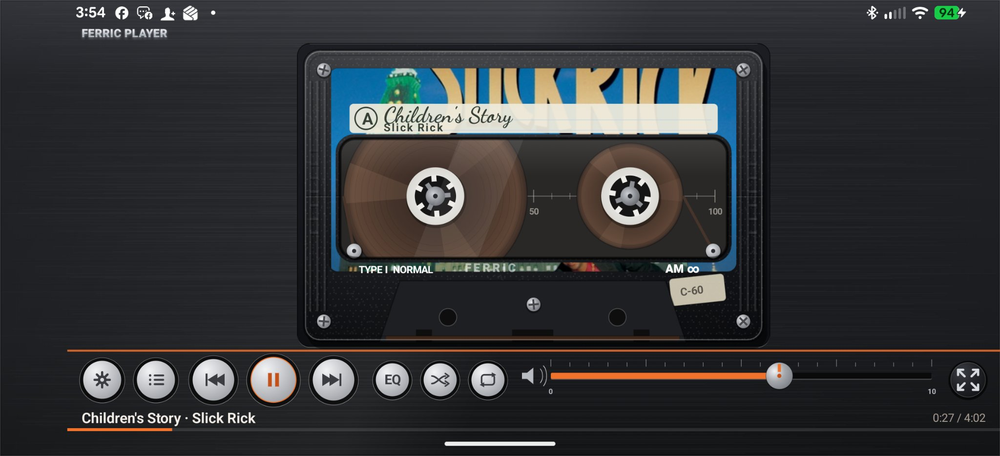
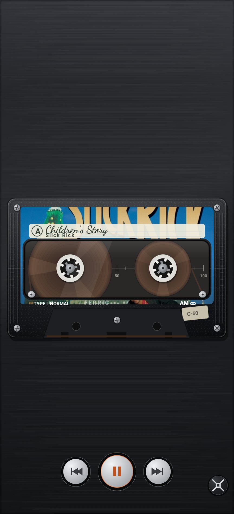
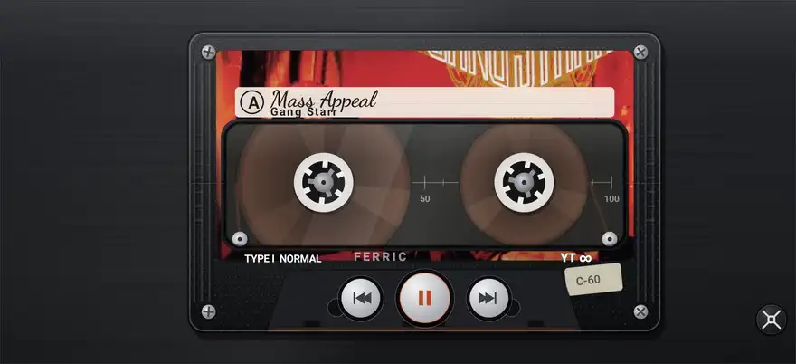

# Ferric Player

**Ferric Player, by Protech Prime Consulting**

A skeuomorphic remote control for the music apps already on your phone. Ferric Player puts YouTube Music and Apple Music behind one cassette deck face, and on foldables and tablets it becomes a full component stereo stack: receiver, dual cassette deck, CD player, and amplifier. It also plays local audio files.

It streams nothing itself. The source apps do the playing; Ferric does the showing and the controlling.



## The machine



Two libraries, two wells. The left well holds YouTube Music, the right well holds Apple Music, each keeping its library's last played track, label, artwork, and place. Tap the parked well and playback hands over to that library.



Folded, it is a cassette deck with honest tape physics, twin VU meters, and a label your albums sign themselves.



Turned sideways, it is a slim personal player in the style of the great 90s portables.



Expanded, the tape takes the whole screen.






## Features

- One deck for YouTube Music, Apple Music, and local files, with per source last track memory in the dual wells
- Real transport everywhere; seek, shuffle, and repeat appear only where the playing app's session actually offers them
- An EQ button that opens your own system wide equalizer app (chosen once, remembered; long press to change). Ferric does not pretend to equalize another app's audio
- Bluetooth and headset controls relayed through Ferric's own media session, so the buttons reach the live deck from either library, and the lock screen shows one consistent controller
- A receiver sleep timer (15, 30, 45, 60 minutes) on the stack
- Orientation lock (auto, portrait, landscape) in Settings
- Meters that read the real audio for local files; for streams, where Android shares no audio, the displays are synthesized and claim nothing else
- No ads, no accounts, no analytics, no data collection

## Requirements and install

- Android 11 or newer
- The official YouTube Music and/or Apple Music app, installed and signed in, for the streaming sources
- Notification access, which Android requires before any app may see other apps' media sessions

Download the APK from the Releases page and install it. The full setup, including the battery manager exclusions that matter on Samsung and other aggressive Android skins, is in the [User Guide](USER-GUIDE.md). Read it before installing; it is honest about every known issue point, and your mileage may vary.

## Building from source

You need JDK 21 and a current Android SDK.

```
gradle :app:assembleRelease
```

Release signing is read from a git ignored `signing.properties` (storeFile, storePassword, keyAlias, keyPassword). Without it, release builds fall back to the debug key, which is exactly what a contributor build should do: official releases are signed with the maintainer's key, and contributor builds cannot overwrite an official install.

## Credits

Ferric Player is built on [Foldman](https://github.com/deveshrai/Foldman) by deveshrai, used under the Apache License 2.0; see LICENSE and NOTICE. The component stack, dual well deck, bridge media session, and the rest of the Ferric treatment are the work of Protech Prime Consulting.

YouTube Music is a trademark of Google LLC. Apple Music is a trademark of Apple Inc. This project is not affiliated with, endorsed by, or sponsored by Google or Apple. All deck artwork is original and drawn in code; no manufacturer's industrial design or brand marks are reproduced. Any resemblance to the great machines of the cassette era is a tribute, and is intended as one.

Listen to the music and enjoy.
